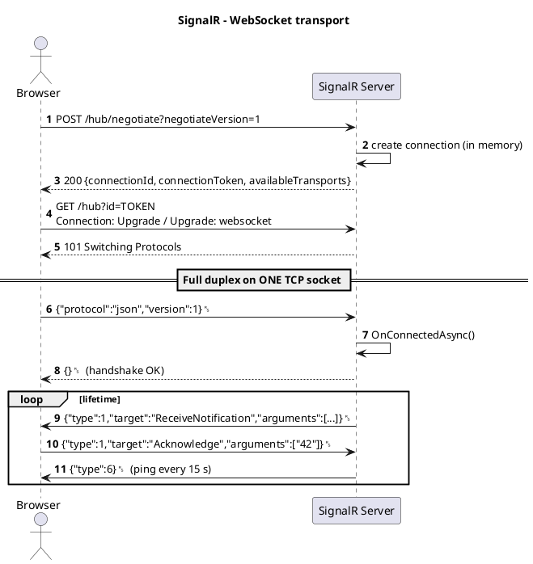
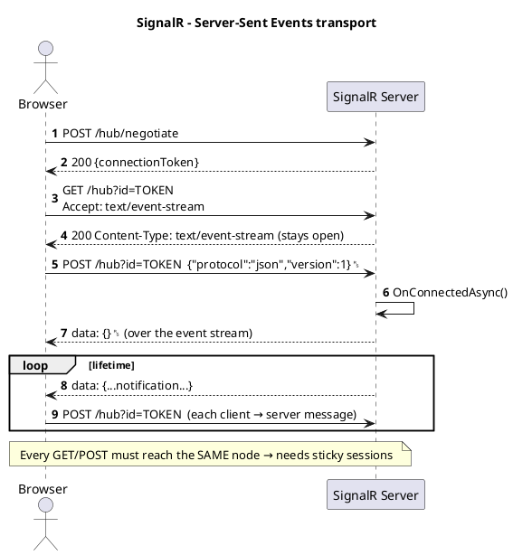
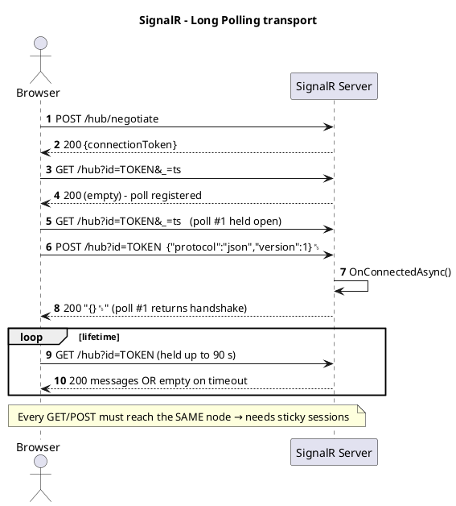
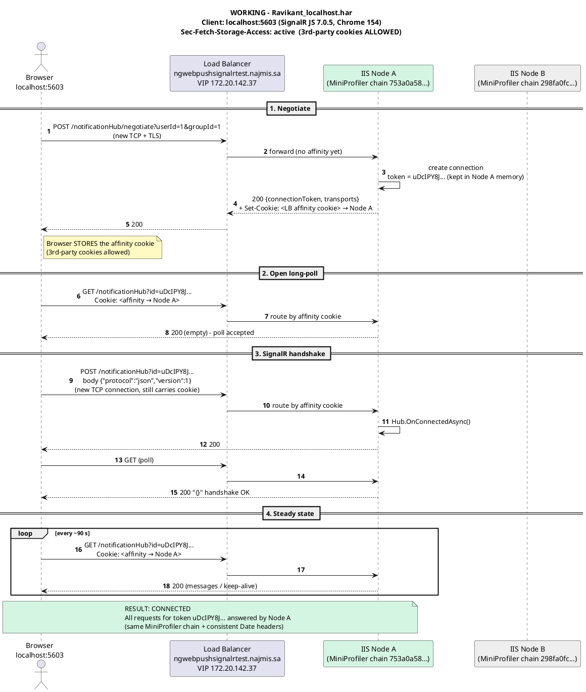
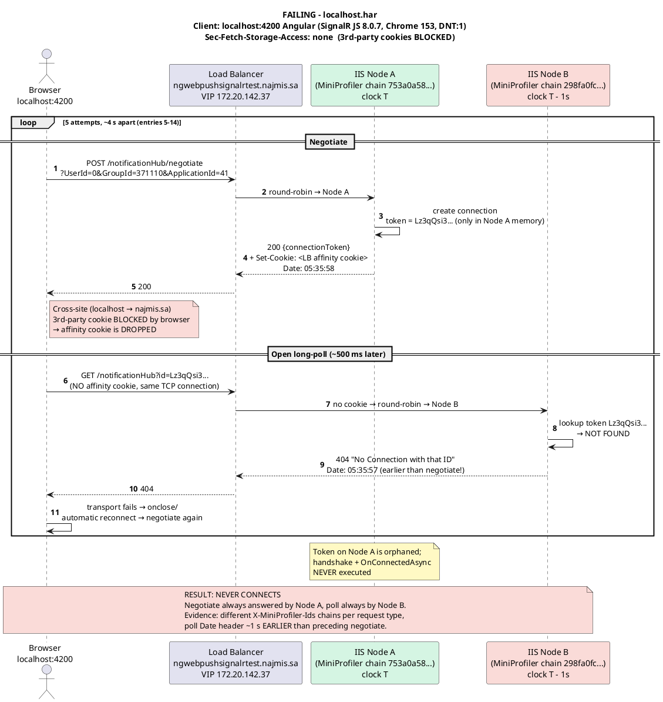
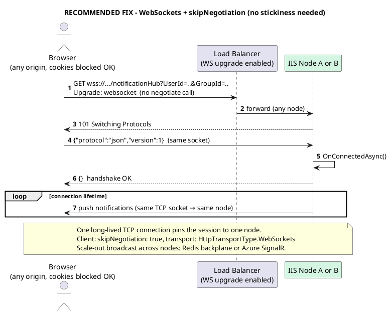
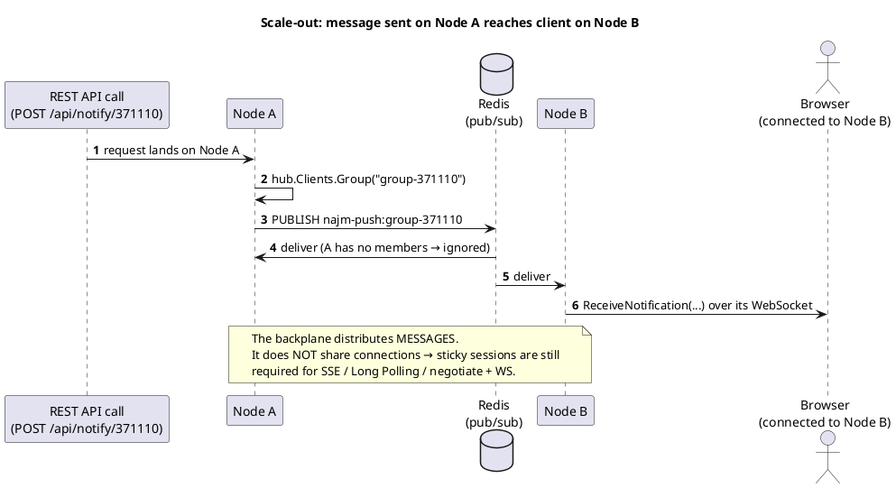

# ASP.NET Core SignalR: Study Guide

How it works, code samples, request flows (PlantUML), common issues, sticky sessions and scalability.
It includes a real case study: the `ngwebpushsignalrtest.najmis.sa` "No Connection with that ID" RCA.

---

## Table of contents

1. [What SignalR is](#1-what-signalr-is)
2. [Core concepts](#2-core-concepts)
3. [How a connection is established](#3-how-a-connection-is-established)
4. [Transports: WebSocket, SSE, Long Polling](#4-transports-websocket-sse-long-polling)
5. [HTTP/1.1 vs HTTP/2](#5-http11-vs-http2)
6. [Server code sample (.NET 8)](#6-server-code-sample-net-8)
7. [Angular client code sample](#7-angular-client-code-sample)
8. [Request flow sequence diagrams (PlantUML)](#8-request-flow-sequence-diagrams-plantuml)
9. [Sticky sessions: when and why](#9-sticky-sessions-when-and-why)
10. [Scalability](#10-scalability)
11. [Common issues and troubleshooting](#11-common-issues-and-troubleshooting)
12. [Case study: the HAR root-cause analysis](#12-case-study-the-har-root-cause-analysis)
13. [Production checklist](#13-production-checklist)

---

## 1. What SignalR is

SignalR is ASP.NET Core's library for **real-time, server-to-client push** (and client-to-server calls) over a persistent connection. It hides the transport details. It picks the best transport the client, network and server all support, and falls back automatically:

```
WebSockets  →  Server-Sent Events  →  Long Polling
 (best)                                 (most compatible)
```

Typical uses: notifications, dashboards, chat, live tracking, progress updates, collaborative editing.

---

## 2. Core concepts

| Concept | Meaning |
|---|---|
| **Hub** | Server class (`Hub` / `Hub<T>`) that clients connect to. It exposes methods clients can call and can call methods on clients. |
| **Connection** | One client session. It has a public `ConnectionId` and a secret `connectionToken` (used in the URL `id=` parameter). |
| **Hub protocol** | Message format on the wire: `json` (default) or `messagepack` (binary). Messages end with the record separator `0x1E`. |
| **Transport** | How bytes move: WebSockets, ServerSentEvents or LongPolling. |
| **Groups** | Named sets of connections (`Groups.AddToGroupAsync`). They are in memory and not persisted. After a reconnect you must add the connection again. |
| **Users** | All connections of one authenticated user (`Clients.User(id)`), resolved via `IUserIdProvider`. |
| **IHubContext** | Lets code **outside** the hub (controllers, background services) send messages. |
| **Backplane** | Shared message bus (Redis / Azure SignalR) so a message sent on node A reaches clients connected to node B. |

---

## 3. How a connection is established

Every connection goes through three phases:

1. **Negotiate** (optional): `POST /hub/negotiate?negotiateVersion=1`
   The server creates the connection **in its own memory** and returns:
   ```json
   {
     "negotiateVersion": 1,
     "connectionId": "mHw7tlZDvGkcMbHGhLo9Tw",
     "connectionToken": "uDcIPY8J99kQTbI3Kem-9A",
     "availableTransports": [
       { "transport": "WebSockets",       "transferFormats": ["Text","Binary"] },
       { "transport": "ServerSentEvents", "transferFormats": ["Text"] },
       { "transport": "LongPolling",      "transferFormats": ["Text","Binary"] }
     ]
   }
   ```
   With Azure SignalR Service, negotiate instead returns a `url` and `accessToken` that redirect the client to the service.

2. **Transport connect**: the client opens the chosen transport using `?id=<connectionToken>`.

3. **Hub handshake**: the client sends `{"protocol":"json","version":1}\u001e` and the server replies `{}\u001e`.
   Only after this does the server run `Hub.OnConnectedAsync()`.

After that, both sides exchange **invocation**, **completion**, **stream** and **ping** messages. Pings are sent every 15 s by default.

> **Key fact for scale-out:** the connection created in step 1 exists **only on the node that answered negotiate**. Every later HTTP request for that connection must reach that same node, unless it all happens over one WebSocket.

---

## 4. Transports: WebSocket, SSE, Long Polling

### 4.1 WebSockets
- HTTP `GET` with `Upgrade: websocket` → `101 Switching Protocols` → full-duplex frames on **one TCP socket**.
- Text + binary, lowest latency and overhead.
- Can skip negotiate entirely (`skipNegotiation: true`), so no affinity is needed.
- Needs every hop (proxy, load balancer, IIS) to support Upgrade. IIS needs the **WebSocket Protocol** feature installed.

### 4.2 Server-Sent Events (SSE)
- `GET` with `Accept: text/event-stream`. The response stays open and the server writes `data: ...\n\n` events.
- **Server → client only.** Every client → server message is a **separate POST**.
- Text only (no MessagePack). The browser `EventSource` can't send custom headers, so the token goes in `?access_token=`.
- Proxies that **buffer responses** break it. Disable response buffering on the proxy.

### 4.3 Long Polling
- Client `GET` waits until the server has data or the **poll timeout (default 90 s)** expires, then immediately issues the next `GET`.
- Sends are separate `POST`s.
- Works everywhere, but has the highest latency and overhead.

### 4.4 Comparison

| | WebSocket | SSE | Long Polling |
|---|---|---|---|
| Direction | Full duplex | Server → client (+POST) | Request/response loop (+POST) |
| Binary (MessagePack) | ✅ | ❌ | ✅ |
| HTTP requests per session | 1 | 1 GET + 1 POST per send | 1 GET per poll + 1 POST per send |
| Needs sticky sessions (multi-node) | ❌ with `skipNegotiation` | ✅ | ✅ |
| Latency | Lowest | Low | Highest |
| Proxy compatibility | Needs Upgrade support | Good (disable buffering) | Best |

---

## 5. HTTP/1.1 vs HTTP/2

| Transport | HTTP/1.1 | HTTP/2 | Notes |
|---|---|---|---|
| WebSocket | ✅ RFC 6455 (`Upgrade`, `101`) | ✅ RFC 8441 (extended `CONNECT`, `200`) | If HTTP/2 WS isn't advertised by the server, the browser opens a separate HTTP/1.1 connection for it. ASP.NET Core 7+ Kestrel supports WS over HTTP/2. |
| SSE | ✅ | ✅ | On HTTP/1.1 each stream uses 1 of the **~6 connections per origin** the browser allows. HTTP/2 multiplexes them. |
| Long Polling | ✅ | ✅ | Same connection-limit concern on HTTP/1.1. |

> In the case study, all traffic to `ngwebpushsignalrtest.najmis.sa` was **HTTP/1.1** (IIS 10 behind a load balancer).

---

## 6. Server code sample (.NET 8)

### 6.1 `Program.cs`

```csharp
using Microsoft.AspNetCore.Http.Connections;

var builder = WebApplication.CreateBuilder(args);

builder.Services.AddSignalR(o =>
{
    o.EnableDetailedErrors      = builder.Environment.IsDevelopment();
    o.KeepAliveInterval         = TimeSpan.FromSeconds(15); // server → client ping
    o.ClientTimeoutInterval     = TimeSpan.FromSeconds(30); // ≥ 2 × client keep-alive
    o.HandshakeTimeout          = TimeSpan.FromSeconds(15);
    o.MaximumReceiveMessageSize = 64 * 1024;                // default 32 KB
})
// Scale-out (pick ONE):
// .AddStackExchangeRedis(builder.Configuration.GetConnectionString("Redis")!,
//      o => o.Configuration.ChannelPrefix =
//               StackExchange.Redis.RedisChannel.Literal("najm-push"));
// .AddAzureSignalR();   // Azure SignalR Service
;

builder.Services.AddCors(o => o.AddPolicy("signalr", p => p
    .WithOrigins("http://localhost:4200", "https://app.najm.sa") // NEVER "*" with credentials
    .AllowAnyHeader()
    .AllowAnyMethod()
    .AllowCredentials()));

var app = builder.Build();

app.UseCors("signalr");
app.UseAuthentication();
app.UseAuthorization();

app.MapHub<NotificationHub>("/notificationHub", o =>
{
    o.Transports = HttpTransportType.WebSockets
                 | HttpTransportType.ServerSentEvents
                 | HttpTransportType.LongPolling;
    o.LongPolling.PollTimeout  = TimeSpan.FromSeconds(90);
    o.AllowStatefulReconnects  = true;                     // .NET 8+
});

// Send from outside the hub (e.g. REST API → push)
app.MapPost("/api/notify/{groupId}", async (
        string groupId, NotificationDto dto,
        IHubContext<NotificationHub, INotificationClient> hub) =>
{
    await hub.Clients.Group($"group-{groupId}").ReceiveNotification(dto);
    return Results.Accepted();
});

app.Run();

public record NotificationDto(string Title, string Body, DateTime CreatedAt);
```

### 6.2 Strongly typed hub

```csharp
using Microsoft.AspNetCore.SignalR;

public interface INotificationClient
{
    Task ReceiveNotification(NotificationDto notification);
}

public class NotificationHub : Hub<INotificationClient>
{
    private readonly ILogger<NotificationHub> _log;
    public NotificationHub(ILogger<NotificationHub> log) => _log = log;

    public override async Task OnConnectedAsync()
    {
        var q       = Context.GetHttpContext()!.Request.Query;
        var userId  = q["UserId"].ToString();
        var groupId = q["GroupId"].ToString();
        var appId   = q["ApplicationId"].ToString();

        if (string.IsNullOrEmpty(groupId))
        {
            Context.Abort();              // reject invalid clients explicitly
            return;
        }

        await Groups.AddToGroupAsync(Context.ConnectionId, $"group-{groupId}");
        if (!string.IsNullOrEmpty(appId))
            await Groups.AddToGroupAsync(Context.ConnectionId, $"app-{appId}");

        _log.LogInformation("Connected {Conn} user={User} group={Group} node={Node}",
            Context.ConnectionId, userId, groupId, Environment.MachineName);

        await base.OnConnectedAsync();
    }

    public override Task OnDisconnectedAsync(Exception? ex)
    {
        _log.LogInformation("Disconnected {Conn} reason={Reason}",
            Context.ConnectionId, ex?.Message ?? "client closed");
        return base.OnDisconnectedAsync(ex);
    }

    // Client → server method
    public Task Acknowledge(string notificationId)
    {
        _log.LogInformation("Ack {Id} from {Conn}", notificationId, Context.ConnectionId);
        return Task.CompletedTask;
    }
}
```

### 6.3 Diagnostic middleware: which node answered?

Add this header temporarily. It makes node flips obvious in a HAR or in DevTools.

```csharp
app.Use(async (ctx, next) =>
{
    ctx.Response.Headers["X-Served-By"] = Environment.MachineName;
    await next();
});
```

---

## 7. Angular client code sample

```bash
npm install @microsoft/signalr
```

### 7.1 `notification.service.ts`

```ts
import { Injectable, OnDestroy } from '@angular/core';
import * as signalR from '@microsoft/signalr';
import { BehaviorSubject, Subject } from 'rxjs';

export interface NotificationDto { title: string; body: string; createdAt: string; }

@Injectable({ providedIn: 'root' })
export class NotificationService implements OnDestroy {
  private hub?: signalR.HubConnection;

  readonly state$         = new BehaviorSubject<signalR.HubConnectionState>(signalR.HubConnectionState.Disconnected);
  readonly notifications$ = new Subject<NotificationDto>();

  async start(userId: number, groupId: number, applicationId: number): Promise<void> {
    const url = `https://ngwebpushsignalrtest.najmis.sa/notificationHub`
              + `?UserId=${userId}&GroupId=${groupId}&ApplicationId=${applicationId}`;

    this.hub = new signalR.HubConnectionBuilder()
      .withUrl(url, {
        // ✅ Recommended for multi-node: one socket = one node, no affinity needed
        skipNegotiation: true,
        transport: signalR.HttpTransportType.WebSockets,
        withCredentials: true,
        // accessTokenFactory: () => this.auth.getToken(),   // if using JWT
      })
      .withAutomaticReconnect([0, 2000, 5000, 10000, 30000])
      .withStatefulReconnect()                               // .NET 8+ server required
      .withServerTimeout(30_000)                             // must match server settings
      .withKeepAliveInterval(15_000)
      .configureLogging(signalR.LogLevel.Information)
      .build();

    this.hub.on('ReceiveNotification', (n: NotificationDto) => this.notifications$.next(n));

    this.hub.onreconnecting(() => this.state$.next(signalR.HubConnectionState.Reconnecting));
    this.hub.onreconnected(()  => this.state$.next(signalR.HubConnectionState.Connected));
    // Groups are re-joined automatically because OnConnectedAsync runs again on reconnect
    this.hub.onclose(err => {
      this.state$.next(signalR.HubConnectionState.Disconnected);
      console.error('SignalR closed', err);
    });

    await this.startWithRetry();
  }

  private async startWithRetry(attempt = 0): Promise<void> {
    try {
      await this.hub!.start();
      this.state$.next(signalR.HubConnectionState.Connected);
    } catch (err) {
      const delay = Math.min(30_000, 2_000 * 2 ** attempt);
      console.warn(`SignalR start failed, retry in ${delay} ms`, err);
      setTimeout(() => this.startWithRetry(attempt + 1), delay);
    }
  }

  acknowledge(id: string) { return this.hub?.invoke('Acknowledge', id); }

  async ngOnDestroy() { await this.hub?.stop(); }
}
```

### 7.2 Fallback when WebSockets are blocked (needs affinity)

```ts
// A client-generated key makes affinity possible WITHOUT cookies:
// the load balancer hashes on ?lbkey=... (all requests keep the query string)
const lbkey = crypto.randomUUID();
.withUrl(`${url}&lbkey=${lbkey}`, {
  transport: signalR.HttpTransportType.ServerSentEvents | signalR.HttpTransportType.LongPolling,
  withCredentials: true
})
```

### 7.3 Local dev: avoid cross-site cookies via the Angular proxy

`proxy.conf.json`

```json
{
  "/notificationHub": {
    "target": "https://ngwebpushsignalrtest.najmis.sa",
    "secure": true,
    "changeOrigin": true,
    "ws": true
  }
}
```

```bash
ng serve --proxy-config proxy.conf.json   # then use url = '/notificationHub?...'
```

---

## 8. Request flow sequence diagrams (PlantUML)

Render with the PlantUML VS Code extension, IntelliJ, `java -jar plantuml.jar file.md`, or https://www.plantuml.com.

### 8.1 WebSocket transport (with negotiate)



### 8.2 Server-Sent Events transport



### 8.3 Long Polling transport



### 8.4 Case study: working flow (affinity cookie accepted)



### 8.5 Case study: failing flow (affinity cookie blocked)



### 8.6 Recommended target: WebSockets + skipNegotiation



### 8.7 Scale-out with a Redis backplane



---

## 9. Sticky sessions: when and why

**Why they are needed:** negotiate creates the connection in **one process's memory**. SSE and long polling then send **many separate HTTP requests** for that connection. If any request lands on a different node, that node answers `404 No Connection with that ID`.

| Deployment | Sticky sessions required? |
|---|---|
| Single server | ❌ |
| Multi-node, **WebSockets only + `skipNegotiation: true`** | ❌ (one socket = one node) |
| Multi-node, WebSockets **with** negotiate | ✅ (negotiate and the WS upgrade must reach the same node) |
| Multi-node, SSE or Long Polling allowed | ✅ |
| Multi-node + **Redis backplane** | ✅ still (the backplane doesn't share connections) |
| **Azure SignalR Service** (default mode) | ❌ on app servers (the service holds client connections) |

### Ways to implement affinity

| Method | Pros | Cons |
|---|---|---|
| **LB cookie** (ARR Affinity, F5 BIGipServer, NGINX sticky) | Standard, easy | Cross-site cookie needs `SameSite=None; Secure`. It fails when 3rd-party cookies are blocked unless the cookie is `Partitioned` (CHIPS). **This was the root cause in the case study.** |
| **Source-IP hash** | No cookies | Breaks behind NAT or SNAT and mobile networks. Distribution is uneven. |
| **Query-parameter hash** (`?lbkey=<uuid>`) | Cookie-free, works in every browser | Needs LB support (F5 universal persistence, NGINX `hash $arg_lbkey consistent`). |
| **Avoid it**: WebSockets + `skipNegotiation` | Simplest, most robust | Requires WebSocket support end to end. |

Example affinity cookie for a cross-site SPA:

```
Set-Cookie: LB_AFFINITY=nodeA; Path=/; Secure; HttpOnly; SameSite=None; Partitioned
```

NGINX example:

```nginx
upstream signalr_nodes {
    hash $arg_lbkey consistent;     # or: ip_hash;  / sticky cookie (NGINX Plus)
    server 10.0.0.11:443;
    server 10.0.0.12:443;
}
server {
    location /notificationHub {
        proxy_pass https://signalr_nodes;
        proxy_http_version 1.1;
        proxy_set_header Upgrade $http_upgrade;
        proxy_set_header Connection "upgrade";
        proxy_read_timeout 120s;    # > LongPolling 90 s and > ping interval
        proxy_buffering off;        # required for SSE
    }
}
```

---

## 10. Scalability

### 10.1 Scale-up (per node)
- Every connection is a **persistent socket** plus memory for buffers. Plan capacity by **concurrent connections**, not requests per second.
- Tune `MaximumReceiveMessageSize`, avoid huge payloads (send an ID, let the client fetch details over REST), and prefer **MessagePack** for bandwidth.
- IIS: raise `maxConcurrentRequestsPerCPU` / app pool queue limits if you use long polling. Make sure the **WebSocket Protocol** feature is installed.
- Keep hub methods **short and async**. Hubs are transient (a new instance per call), so never store state in hub fields.

### 10.2 Scale-out (many nodes)

| Option | How it works | Sticky needed | Notes |
|---|---|---|---|
| **Redis backplane** | Each node publishes messages to Redis pub/sub; all nodes forward to their local clients | ✅ (unless WS + skipNegotiation) | Self-hosted. Redis becomes a critical dependency; use a channel prefix per app/env. |
| **Azure SignalR Service** | Clients connect to the service; app servers keep a few server connections to it | ❌ | Managed, scales to very large connection counts, handles transports. Paid per unit. |
| **Custom bus** (Service Bus / Kafka → `IHubContext` on every node) | Background worker on each node consumes and broadcasts | ✅ (same as Redis) | When you already have a bus; more code. |

### 10.3 Design tips
- **Group by business key** (`group-{GroupId}`, `app-{ApplicationId}`) and send to groups, not to connection lists stored in a database.
- Groups are **not persisted**. Rejoin them in `OnConnectedAsync`, which runs on every (re)connect.
- Push small **events** and let clients fetch data. Make handlers **idempotent**, because messages can be lost during reconnect unless you use stateful reconnect (.NET 8).
- Use `IHubContext` from APIs and background services, and keep business logic out of hubs.
- Make keep-alive and timeouts consistent across client, server, load balancer and proxies:
  `client serverTimeout (30 s) ≥ 2 × server KeepAlive (15 s)`, and `server ClientTimeout (30 s) ≥ 2 × client keepAlive (15 s)`, and `LB idle timeout > 90 s`.

---

## 11. Common issues and troubleshooting

| Symptom | Likely cause | Fix |
|---|---|---|
| `404 No Connection with that ID` right after negotiate | Request landed on a **different node** (no or broken affinity) | Sticky sessions, or WS + `skipNegotiation`, or Azure SignalR. See §12. |
| `404` after a long idle period | Connection timed out / server restarted / app pool recycled | Normal. Rely on `withAutomaticReconnect`. Check the IIS recycle schedule. |
| CORS error on negotiate | Missing `AllowCredentials()` or using `AllowAnyOrigin()` with credentials | `.WithOrigins(...).AllowCredentials()` |
| WebSocket fails, falls back to SSE/LP | LB/proxy strips `Upgrade`, IIS WebSocket feature missing, corporate proxy | Enable WS end to end. Check `101` in DevTools → Network → WS. |
| WS close code **1006** | Idle timeout on the LB/proxy/firewall, or network drop | Raise the idle timeout. Keep-alive ping ≤ 15 s. |
| SSE connects but no messages arrive | Proxy **response buffering** or compression | `proxy_buffering off`. Disable dynamic compression for `text/event-stream`. |
| `Server timeout elapsed without receiving a message` | Server keep-alive > client serverTimeout, or a blocked thread pool | Align timeouts. Avoid sync-over-async in hubs. |
| `Handshake was canceled` | Handshake > 15 s (cold start, overloaded node) | Warm-up, scale, or raise `HandshakeTimeout`. |
| 401 on WS/SSE but REST works | Token can't go in headers for WS/SSE | Use `accessTokenFactory`. Server reads `access_token` from the query in `JwtBearerEvents.OnMessageReceived`. |
| Other requests stall while SignalR is open | HTTP/1.1 limit of about 6 connections per origin (SSE/LP) | Use HTTP/2 or WebSockets, or a separate subdomain. |
| Clients stop getting group messages after reconnect | Groups aren't persisted | Re-add to groups in `OnConnectedAsync`. |
| Messages reach only some users in a farm | No backplane | Redis backplane or Azure SignalR. |
| Messages bigger than 32 KB fail / connection closes | `MaximumReceiveMessageSize` | Raise the limit or send smaller payloads. |
| Works in one browser, fails in another | Browser cookie policy (3rd-party blocked, DNT, incognito) | Don't rely on cross-site cookies. See §9. |

### Debug toolkit
- **Client logs:** `.configureLogging(signalR.LogLevel.Trace)`
- **Server logs:** `"Logging": { "LogLevel": { "Microsoft.AspNetCore.SignalR": "Debug", "Microsoft.AspNetCore.Http.Connections": "Debug" } }`
- **DevTools → Network:** filter `notificationHub`. Check status codes, the WS **Messages** tab, and the **Cookies** tab (with "show filtered out request cookies" ticked).
- **HAR analysis:** compare `connectionToken`, the server `Date` header, node-specific headers (`X-Served-By`, `X-MiniProfiler-Ids`), and `Sec-Fetch-Storage-Access`.
- **Node header:** add the `X-Served-By` middleware (§6.3) to see which node answered each request.

---

## 12. Case study: the HAR root-cause analysis

**Environment:** `ngwebpushsignalrtest.najmis.sa` runs IIS 10 behind a load balancer (VIP `172.20.142.37`) with **at least two nodes**, over HTTP/1.1 with the long-polling transport.

| | Working (`Ravikant_localhost.har`) | Failing (`localhost.har`) |
|---|---|---|
| Origin | `http://localhost:5603` | `http://localhost:4200` (Angular) |
| SignalR JS | 7.0.5 | 8.0.7 |
| `Sec-Fetch-Storage-Access` | **active** | **none** |
| Negotiate → first poll | 200 → 200 | 200 → **404 "No Connection with that ID"** |
| Node answering negotiate | A | A |
| Node answering poll | A | **B** |

**Evidence:**
1. The 404 arrives about 500 ms after a successful negotiate, **before** the handshake. Hub code never runs, so this isn't an application bug.
2. `X-MiniProfiler-Ids` (a node-local, in-memory list) shows one chain on every negotiate and a completely different chain on every poll. That means two different servers.
3. The server `Date` on the poll is about 1 s **earlier** than on the negotiate before it, which points to clock skew between two machines.
4. The working client's requests all return the same chain, so it has affinity.
5. The only relevant client difference is that the failing browser blocks third-party cookies (`Sec-Fetch-Storage-Access: none`, `DNT: 1`). The cross-site LB affinity cookie is dropped, so the LB round-robins.

**Root cause:** cookie-based LB affinity doesn't survive a cross-site browser context with third-party cookies blocked. Negotiate and poll land on different nodes.

**Fixes (in order of preference):**
1. WebSockets + `skipNegotiation: true` (no affinity needed), with Redis or Azure SignalR for broadcast.
2. Cookie-free affinity via a query-parameter hash (`?lbkey=`).
3. Affinity cookie with `SameSite=None; Secure; Partitioned`.
4. Dev only: the Angular proxy (`proxy.conf.json`) so the calls become first-party.

---

## 13. Production checklist

- [ ] WebSocket Protocol feature installed on IIS; LB passes `Upgrade`/`Connection`
- [ ] Transport strategy decided: WS + `skipNegotiation`, **or** sticky sessions verified for SSE/LP
- [ ] If sticky sessions use a cookie, it has `SameSite=None; Secure` (and `Partitioned` for cross-site SPAs)
- [ ] Backplane (Redis) or Azure SignalR configured for multi-node broadcast
- [ ] CORS: explicit origins + `AllowCredentials()`
- [ ] Auth: `accessTokenFactory` on the client, `access_token` query handling on the server
- [ ] Timeouts aligned: client 30/15 s, server 30/15 s, LB idle > 90 s
- [ ] `withAutomaticReconnect` + rejoin groups in `OnConnectedAsync`
- [ ] Stateful reconnect considered (.NET 8+)
- [ ] Payloads small; `MaximumReceiveMessageSize` reviewed
- [ ] Proxy buffering off (SSE), dynamic compression off for `text/event-stream`
- [ ] Logging for `Microsoft.AspNetCore.SignalR` / `Http.Connections`; `X-Served-By` header in test environments
- [ ] Load test with realistic concurrent connections per node
