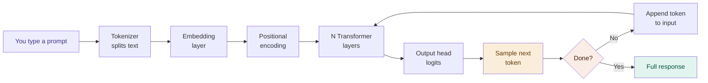

# The Big Picture — Prompt to Answer in 7 Steps

## Problem It Solves

You type "What is the capital of France?" and get "Paris." How? Something has to convert raw text into numbers, process meaning, and produce a response — all without truly "understanding" anything. The transformer pipeline solves this by breaking the problem into precise, learnable steps.

## How It Works

Every time you send a prompt, these 7 steps execute in order:

```
┌─────────────────────────────────────────────────────────┐
│  PROMPT → TOKEN IDs → VECTORS → ATTENTION → LAYERS      │
│        → LOGITS → SAMPLE → NEXT TOKEN → REPEAT          │
└─────────────────────────────────────────────────────────┘

Step 1  You type a prompt
        "What is the capital of France?"

Step 2  Tokenizer splits text into tokens
        ["What", " is", " the", " capital", " of", " France", "?"]
        → [2061, 374, 279, 6864, 315, 9822, 30]

Step 3  Embedding layer converts IDs to vectors
        Each token ID → a list of ~4096 numbers
        (a point in a high-dimensional meaning-space)

Step 4  Positional encoding adds order
        Each vector gets a small position signal added
        So token #3 ≠ token #1, even if same word

Step 5  N Transformer layers process context
        ~96 layers of (Attention + FFN)
        Every token can "see" every other token
        Representations get refined at each layer

Step 6  Output head predicts next token
        Final vector → projection over entire vocab
        → probability distribution over 50,000+ tokens

Step 7  Sample one token, append, repeat
        "Paris" chosen → appended to input
        Entire forward pass runs again for next token
```

## When to Use This Mental Model

- Any time someone asks "how does ChatGPT work?"
- Debugging why a model responds a certain way
- Understanding why context length matters
- Explaining why generation is slow (step 7 repeats)

## When NOT to Oversimplify

- "It just predicts the next word" — technically true but undersells how much emerges from doing this at scale
- The model is not a lookup table — the patterns generalise to never-seen combinations

## Trade-offs

| What the architecture gains | What it costs |
|----------------------------|---------------|
| Handles any text task | Huge memory (billions of parameters) |
| Parallelisable training | Inference is sequential (one token at a time) |
| Long-range context via attention | Quadratic cost in sequence length |
| General-purpose | No persistent memory between conversations |

## Real World Example

**ChatGPT (GPT-4):** Estimated 1.8 trillion parameters. ~128K token context window. Runs these 7 steps for every token it generates. Generating a 500-word response ≈ ~400 forward passes through ~96 layers each.

**Claude:** Same pipeline. Context windows up to 200K tokens. Anthropic adds RLHF (Constitutional AI) on top of the base next-token prediction.

## Interview Soundbite

> "An LLM is a next-token predictor. It converts text to token IDs, looks up learned embedding vectors, passes them through N transformer layers where every token attends to every other, then projects the final vector onto a vocabulary distribution to sample the next token — and repeats until done."

---

## Diagram



---

## Common Misconceptions

| Misconception | Reality |
|---------------|---------|
| "It searches the internet" | No. It predicts tokens from learned weights. No retrieval unless explicitly added (RAG). |
| "It knows everything" | It knows patterns from training data up to a cutoff. Post-cutoff = no knowledge. |
| "It thinks like a human" | No internal monologue. No persistent state. Every conversation starts fresh. |
| "Larger = always better" | Larger models are better but also slower and more expensive. Smaller fine-tuned models often outperform large base models on specific tasks. |
