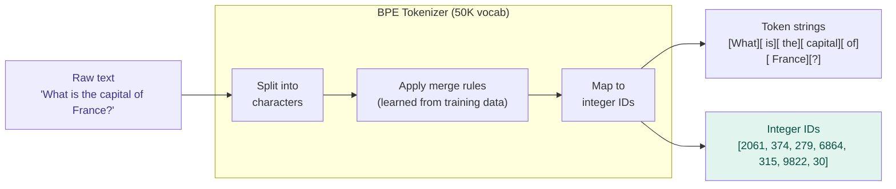

# Tokenization — Text into Numbers

## Problem It Solves

Neural networks process numbers, not text. We need a consistent, reversible way to convert any possible string into a sequence of integers. The tokenizer is that converter — it must handle any language, punctuation, code, emoji, and edge cases, using a fixed vocabulary learned from data.

## How It Works

**Algorithm: BPE — Byte Pair Encoding**

BPE is trained by:
1. Starting with every individual character as a token
2. Counting the most frequent adjacent pair
3. Merging that pair into a single new token
4. Repeat until vocabulary reaches target size (~50K)

Result: Common words = 1 token. Rare/long words = several sub-word tokens.

```
┌──────────────────────────────────────────────────────┐
│  TOKENIZATION EXAMPLES                               │
├──────────────────────────────────────────────────────┤
│                                                      │
│  "What is the capital of France?"                    │
│   ↓                                                  │
│  ["What"] [" is"] [" the"] [" capital"]              │
│  [" of"] [" France"] ["?"]                          │
│  = 7 tokens                                          │
│                                                      │
│  "Transformer"                                       │
│  → ["Trans"] ["former"]  = 2 tokens                 │
│                                                      │
│  "zzqxw"  (gibberish)                               │
│  → ["z"]["z"]["q"]["x"]["w"]  = 5 tokens            │
│                                                      │
│  "ChatGPT"                                           │
│  → ["Chat"]["G"]["PT"]  = 3 tokens                  │
│                                                      │
│  " " (space) is often merged WITH next word:         │
│  "is" vs " is" are DIFFERENT tokens!                 │
└──────────────────────────────────────────────────────┘
```

## The Vocabulary Table

```
Token string  →  Integer ID
────────────────────────────
"What"        →  2061
" is"         →  374
" the"        →  279
" capital"    →  6864
" of"         →  315
" France"     →  9822
"?"           →  30
...
Total vocab:  ~50,257 (GPT-2) to ~100K+ (modern models)
```

## When to Use (Understanding this concept)

- Debugging why the model handles some text poorly (rare words tokenize badly)
- Estimating cost — APIs charge per token, not per word
- Understanding why code/math performance varies (symbols = many tokens)
- Building prompts that are token-efficient

## When Things Break

| Input type | What happens | Why it's a problem |
|------------|-------------|-------------------|
| Rare proper nouns | Split into many sub-tokens | Model sees fragmented representations |
| Numbers | "12345" → ["1234"]["5"] varies | Arithmetic is hard for LLMs |
| Non-English text | More tokens per word | Higher cost, shorter effective context |
| Code symbols | `->`, `::`, `{}` split unpredictably | Syntax-sensitive tasks hurt |

## Trade-offs

| Larger vocabulary | Smaller vocabulary |
|-------------------|-------------------|
| Most words = 1 token | Many words split |
| Longer embedding table (memory) | Smaller embedding table |
| Rarer tokens trained less | All tokens seen frequently |
| Better rare-word handling | Worse rare-word handling |

## Real World Example

**OpenAI tiktoken (GPT-4):** cl100k_base vocabulary with ~100K tokens. The word "unbelievable" is a single token. The word "Antidisestablishmentarianism" splits into 6 tokens.

**LLaMA:** SentencePiece BPE with 32K vocabulary. Cheaper but more fragmentation for English.

**Practical implication:** A typical English word ≈ 0.75 tokens. A 1,000-word essay ≈ ~750 tokens. At $0.03/1K tokens (GPT-4), that's ~$0.02 per essay.

## Interview Soundbite

> "Tokenization converts raw text into integer IDs using BPE — a learned merge table that collapses frequent character pairs into single tokens. Common English words are usually one token. Rare words, numbers, and non-English text fragment into multiple tokens, which is why LLMs handle those domains less reliably."

---

## Diagram



---

## Key Numbers to Remember

```
┌────────────────────────────────────────┐
│  GPT-2 vocab:    50,257 tokens         │
│  GPT-4 vocab:    ~100,000 tokens       │
│  LLaMA vocab:    32,000 tokens         │
│  Avg English:    ~0.75 tokens/word     │
│  Context limit:  1 token ≈ ~4 chars    │
└────────────────────────────────────────┘
```
