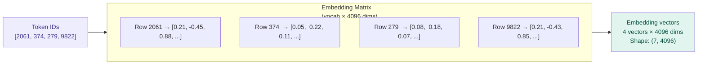

# Embeddings — Token IDs into Meaning Vectors

## Problem It Solves

Token IDs are arbitrary integers — "France" = 9822 tells us nothing about meaning. We need a representation where similar words are numerically similar, so the model can generalise: knowing "France has a capital" should help it handle "Germany has a capital" too. Embeddings solve this by mapping each token to a learned point in a high-dimensional space where meaning = geometry.

## How It Works

The embedding layer is a **lookup table**: a matrix of shape `(vocabulary_size × embedding_dim)`.

```
┌──────────────────────────────────────────────────────────┐
│  EMBEDDING LOOKUP TABLE  (simplified to 4 dims)          │
├────────────┬──────────────────────────────────────────────┤
│  Token     │  Embedding vector (4096 dims, shown as 4)   │
├────────────┼──────────────────────────────────────────────┤
│  "France"  │  [0.21, -0.45, 0.88, 0.33, ...]             │
│  "Germany" │  [0.19, -0.43, 0.85, 0.31, ...]  ← similar  │
│  "Paris"   │  [0.55,  0.12, 0.91, 0.44, ...]             │
│  "Berlin"  │  [0.53,  0.11, 0.88, 0.42, ...]  ← similar  │
│  "cat"     │  [-0.3,  0.67, 0.21, -0.55, ...] ← different│
└────────────┴──────────────────────────────────────────────┘

Similar meanings → similar numbers → nearby points in space
```

## The Geometric Intuition

```
KING - MAN + WOMAN ≈ QUEEN

This works because the model learns a "royalty direction",
a "gender direction", etc. in the embedding space.

embedding("France") ≈ embedding("Germany") + direction("language difference")

Capital relationship:
  Paris - France ≈ Berlin - Germany ≈ Tokyo - Japan
  The "capital city" direction is a learnable geometric relationship.
```

## When to Use This Understanding

- Explaining why models generalise across similar words
- Understanding why fine-tuning on related domains helps
- Designing retrieval systems (semantic search uses embeddings)
- Explaining why LLMs handle analogies and wordplay

## When NOT to Oversimplify

- "Words with similar meanings are close" — true for content words, but function words ("the", "of") cluster differently based on their syntactic role
- Embeddings change through layers — what enters the transformer is different from what exits each layer (residual stream)

## Trade-offs

| Higher embedding dimension | Lower embedding dimension |
|---------------------------|--------------------------|
| Richer representations | Faster computation |
| Better generalisation | Less expressive |
| More memory | Fits in smaller hardware |
| GPT-4 class: ~12,288 | GPT-2 small: 768 |

## Real World Example

**Word2Vec (2013):** First famous demonstration that `king - man + woman ≈ queen`. Showed that geometry in embedding space = semantic relationships.

**OpenAI text-embedding-ada-002:** 1536-dimensional embeddings used for semantic search. Powers ChatGPT's retrieval features and thousands of production apps.

**Claude:** Embeddings are NOT shared externally — but the same principle underlies Anthropic's internal representations.

## Interview Soundbite

> "Embeddings are a learned lookup table mapping token IDs to dense vectors. Similar tokens end up near each other in this high-dimensional space because they appear in similar contexts during training. This lets the model generalise: learning facts about France helps with Germany because their vectors are nearby."

---

## Diagram



---

## Key Numbers to Remember

```
┌────────────────────────────────────────────────┐
│  GPT-2 small:    768-dim embeddings            │
│  GPT-3 (175B):   12,288-dim embeddings         │
│  GPT-4 class:    ~12,288-dim embeddings        │
│  LLaMA-7B:       4,096-dim embeddings          │
│                                                │
│  Total embedding params = vocab × dim          │
│  GPT-3: 50,257 × 12,288 ≈ 617M params just    │
│  for the embedding table!                      │
└────────────────────────────────────────────────┘
```
