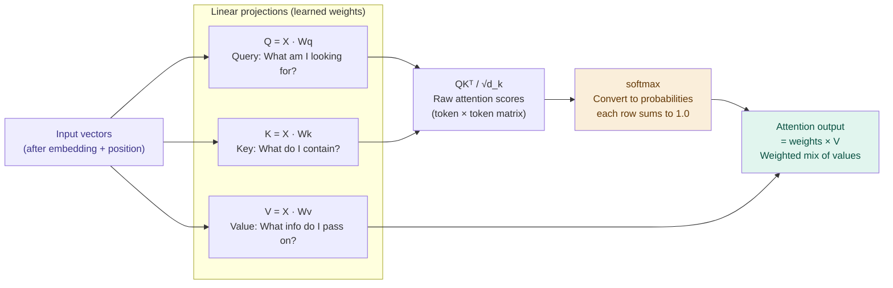

# Self-Attention — Every Token Looks at Every Other

## Problem It Solves

In a sentence like "The animal didn't cross the street because it was too tired", what does "it" refer to? Humans instantly know: the animal. But a model processing one word at a time can't make this link. Self-attention solves this by letting every token simultaneously look at every other token and decide how much to "pay attention to" each one when building its representation.

## How It Works

Every token produces three vectors via learned weight matrices:

```
┌─────────────────────────────────────────────────────────┐
│  Q = Query   "What am I looking for?"                   │
│  K = Key     "What do I contain?"                       │
│  V = Value   "What information do I pass on?"           │
└─────────────────────────────────────────────────────────┘

Step 1: Compute attention scores
  score(i, j) = Q[i] · K[j]        (dot product)
  
  → How much should token i attend to token j?
  → High score = relevant. Low score = ignore.

Step 2: Scale to prevent vanishing gradients
  scaled_score = score / √d_k
  
  → d_k = key/query dimension
  → Without scaling, dot products grow large for big d_k
  → Large values push softmax into saturation

Step 3: Softmax → probabilities
  attention_weights = softmax(scaled_scores)
  
  → Each row sums to 1.0
  → Row i = "how much does token i attend to each token?"

Step 4: Weighted sum of Values
  output = attention_weights × V
  
  → Each token's new representation = mix of all tokens'
    Values, weighted by how much attention it paid them
```

## The Full Formula

```
Attention(Q, K, V) = softmax( QKᵀ / √d_k ) · V
                              ↑         ↑      ↑
                      raw scores  scaling  weighted
                      (dot prod)           mix of values
```

## Worked Example — "What is the capital of France?"

```
When processing the token "capital":
  
  "capital" asks (Q): "What do I relate to?"
  
  Each token answers (K):
    "What"    K score: 0.08   → 8%  attention
    "is"      K score: 0.08   → 8%  attention
    "the"     K score: 0.12   → 12% attention
    "capital" K score: 0.42   → 42% attention  ← itself!
    "of"      K score: 0.08   → 8%  attention
    "France"  K score: 0.16   → 16% attention  ← key link!
    "?"       K score: 0.06   → 6%  attention
  
  Output for "capital" = weighted mix of all V vectors
  → heavily influenced by "France" (16%) and itself (42%)
  → This is how "capital" learns it belongs to "France"!
```

## Visual Attention Matrix

```
              attending TO →
              What  is  the  capital  of  France  ?
attend    What  [55%  10%   5%    8%   5%   12%   5%]
FROM      is    [15%  40%  15%   10%   8%    8%   4%]
  ↓       the   [ 8%  18%  35%   12%  10%   10%   7%]
       capital  [ 6%   8%  12%   42%   8%   16%   8%]
          of    [ 5%   6%  10%    8%  38%   28%   5%]
       France   [ 4%   5%   8%   20%  12%   45%   6%]
          ?     [ 8%   8%  10%   15%  10%   35%  14%]
```

Higher % = darker colour = stronger attention

## When to Use

- Any task requiring understanding relationships between words
- This is why transformers beat RNNs: RNNs process sequentially and forget distant context, attention has direct access to any token

## When Attention Has Limits

- Context window limit: you can only attend to tokens that fit in the window
- Quadratic cost: attention matrix is `(seq_len × seq_len)` — a 100K context = 10 billion entries
- Doesn't understand causality, just co-occurrence

## Trade-offs

| Self-attention | Older approaches (RNN/LSTM) |
|---------------|-----------------------------|
| Direct access to any token | Must "remember" through hidden state |
| Parallelisable training | Sequential (slow) |
| O(n²) in sequence length | O(n) in sequence length |
| Handles long-range dependencies | Struggles beyond ~100 tokens |
| Foundation of all modern LLMs | Largely replaced for NLP |

## Real World Example

**BERT (Google, 2018):** First model to show bidirectional attention (every token attends to every other, including future tokens) beats autoregressive approaches for understanding tasks. Powers Google Search's understanding of queries.

**GPT (OpenAI):** Causal/masked attention — token i can only attend to tokens 1..i (no looking ahead). This is how autoregressive generation works.

## Interview Soundbite

> "Self-attention lets every token simultaneously compute a weighted average of all other tokens' value vectors. The weights come from a dot-product similarity between each token's query and every other token's key, scaled by √d and normalised with softmax. This gives the model direct access to any part of the context, regardless of distance."

---

## Diagrams

### The QKV mechanism



### Attention as a heatmap (for our example)

```
"capital" attends to:
  France  ████████████████ 16%   ← strong link
  capital ████████████████████████████████████████ 42% ← self
  the     ████████ 12%
  of      ████████ 8%
  ...
```
