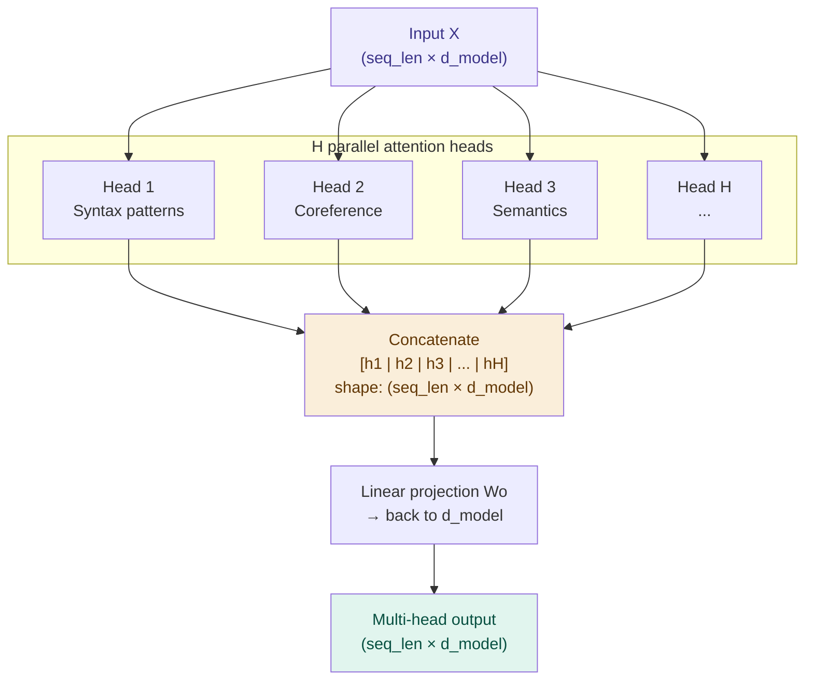

# Multi-Head Attention — Parallel Pattern Detection

## Problem It Solves

A single attention operation can only look for one "type" of relationship at a time. But language has many simultaneous patterns: syntax (subject-verb agreement), coreference ("it" → "animal"), semantic similarity, positional proximity. Multi-head attention runs several attention operations in parallel, each learning different patterns, then combines them.

## How It Works

```
┌──────────────────────────────────────────────────────────┐
│  SINGLE ATTENTION = one set of Q, K, V                   │
│  MULTI-HEAD = H parallel attention operations            │
│                                                          │
│  Input X                                                 │
│     │                                                    │
│     ├──→ Head 1 (W1_Q, W1_K, W1_V) → output1           │
│     ├──→ Head 2 (W2_Q, W2_K, W2_V) → output2           │
│     ├──→ Head 3 (W3_Q, W3_K, W3_V) → output3           │
│     │    ...                                             │
│     └──→ Head H (WH_Q, WH_K, WH_V) → outputH           │
│                                                          │
│  Concatenate all head outputs:                           │
│  [output1 | output2 | ... | outputH]                     │
│     │                                                    │
│  Final linear projection Wo:                             │
│  MultiHead(Q,K,V) = Concat(head1..H) · Wo               │
└──────────────────────────────────────────────────────────┘
```

## What Different Heads Learn

Research on attention patterns (from interpretability work) shows heads specialize:

```
┌──────────────────────────────────────────────────────────┐
│  HEAD SPECIALISATIONS (observed empirically)             │
├──────────────────────────────────────────────────────────┤
│  Syntactic heads    → Subject-verb agreement             │
│                       "The cats [are/is] sleeping"       │
├──────────────────────────────────────────────────────────┤
│  Coreference heads  → Pronoun resolution                 │
│                       "it" → "animal" (not "street")    │
├──────────────────────────────────────────────────────────┤
│  Positional heads   → Adjacent token relationships       │
│                       "New" → "York"                    │
├──────────────────────────────────────────────────────────┤
│  Semantic heads     → Meaning similarity                 │
│                       "capital" ↔ "France"              │
├──────────────────────────────────────────────────────────┤
│  Rare heads         → Hard to interpret — often          │
│                       emergent task-specific circuits   │
└──────────────────────────────────────────────────────────┘
```

## The Dimension Split

Each head works in a smaller dimensional space:

```
Full embedding dim = d_model = 4096
Number of heads H = 32 (typical)
Per-head dim = d_model / H = 4096 / 32 = 128

→ Each head projects to 128-dim Q, K, V
→ All heads run in parallel (same wall-clock time!)
→ Concat gives back 32 × 128 = 4096 dims
→ Final Wo project back to d_model
```

## When to Use This Understanding

- Explaining why transformers outperform single-attention models
- Discussing interpretability (mechanistic interpretability studies what heads do)
- Understanding why some heads can be pruned without much loss

## When NOT to Over-Specify

- The "syntax head", "coreference head" characterisation is approximate — heads are not cleanly interpretable in large models
- Some research shows removing individual heads has minimal effect — distributed redundancy

## Trade-offs

| More heads | Fewer heads |
|------------|-------------|
| Detect more relationship types | Simpler, faster |
| Each head smaller (less expressive) | Each head richer |
| GPT-4: estimated ~96 heads | GPT-2 small: 12 heads |
| Parallelisable on GPU | — |

## Real World Example

**GPT-3 (175B):** 96 attention heads, each 128-dim, in 96 layers. That's 96 × 96 = 9,216 distinct attention patterns across the model.

**BERT-large:** 16 heads, 12 layers = 192 attention heads total. Analysis by Voita et al. (2019) showed ~8 "confident" heads handle most tasks; others are redundant and can be pruned.

**Mechanistic interpretability (Anthropic):** Research identifies specific "induction heads" that implement in-context learning — one of the clearest examples of a human-interpretable circuit in a large model.

## Interview Soundbite

> "Multi-head attention runs H independent attention operations in parallel, each projecting to a lower-dimensional space. Because each head has different learned weight matrices, each specialises in different relationship types — syntax, coreference, semantics, position. Their outputs are concatenated and projected back to the full dimension."

---

## Diagram


