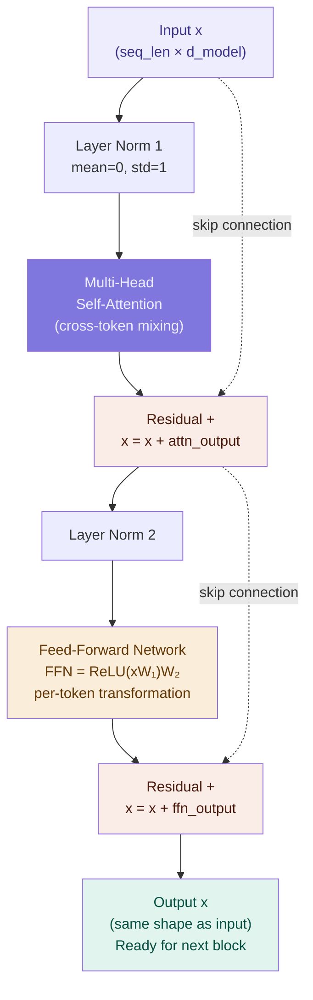

# Transformer Layer Anatomy — Inside One Layer

## Problem It Solves

One attention operation is powerful but not enough. A single layer can detect relationships but can't reason about them in complex ways. Stacking many layers — each refining the representation — lets early layers detect syntax, middle layers capture facts, and late layers reason about tasks. Each layer follows the same blueprint: Norm → Attention → Residual → Norm → FFN → Residual.

## How It Works

One transformer block (repeated N times):

```
┌──────────────────────────────────────────────────────────┐
│  ONE TRANSFORMER BLOCK (used ~96 times in large models)  │
├──────────────────────────────────────────────────────────┤
│                                                          │
│  Input x                                                 │
│     │                                                    │
│  ┌──▼──────────────────────────────────────────────┐    │
│  │  Layer Norm                                     │    │
│  │  Rescale to mean≈0, std≈1                       │    │
│  └──┬─────────────────────────────────────────────┘    │
│     │                                                    │
│  ┌──▼──────────────────────────────────────────────┐    │
│  │  Multi-Head Self-Attention                      │    │
│  │  Every token attends to every other token       │    │
│  └──┬─────────────────────────────────────────────┘    │
│     │                                                    │
│  ┌──▼──────────────────────────────────────────────┐    │
│  │  Residual connection: x = x + attention_output  │    │
│  │  (Skip connection — input added back)           │    │
│  └──┬─────────────────────────────────────────────┘    │
│     │                                                    │
│  ┌──▼──────────────────────────────────────────────┐    │
│  │  Layer Norm                                     │    │
│  └──┬─────────────────────────────────────────────┘    │
│     │                                                    │
│  ┌──▼──────────────────────────────────────────────┐    │
│  │  Feed-Forward Network (FFN)                     │    │
│  │  FFN(x) = max(0, xW₁+b₁)W₂+b₂                 │    │
│  │  4× wider than embedding dim                   │    │
│  │  Processes each token INDEPENDENTLY             │    │
│  └──┬─────────────────────────────────────────────┘    │
│     │                                                    │
│  ┌──▼──────────────────────────────────────────────┐    │
│  │  Residual connection: x = x + ffn_output        │    │
│  └──┬─────────────────────────────────────────────┘    │
│     │                                                    │
│  Output x (same shape as input — ready for next block)  │
└──────────────────────────────────────────────────────────┘
```

## What Each Sub-Component Does

### 1. Layer Normalisation

```
LayerNorm(x) = (x - mean) / std  × γ + β

Where γ, β are learned parameters (scale and shift)

Purpose:
  - Prevents activation explosion/vanishing across many layers
  - Applied BEFORE attention (pre-norm) in GPT-style models
  - Stabilises training, enables deeper networks
```

### 2. Multi-Head Self-Attention

```
The core mechanism. Every token creates Q, K, V vectors.
Attention weights are computed → each token's output is
a weighted mix of all tokens' values.

(See 04-Attention/01-self-attention.md for full detail)

Key property: mixes information ACROSS tokens
Attention sees the whole sequence at once.
```

### 3. Residual Connection

```
output = x + sub_layer(x)
           ↑
    original input added back

Why this matters:
  - Gradients flow directly from output to early layers
  - Layer can learn "change" rather than "replace"
  - If the sub-layer learns nothing useful, x passes through
  - Enables training of very deep networks (100+ layers)
  - Without residuals: gradient vanishes by layer 10-20
```

### 4. Feed-Forward Network (FFN)

```
FFN(x) = max(0, xW₁ + b₁) W₂ + b₂
          ↑
         ReLU or GELU activation

Key numbers:
  d_model = 4096
  d_ffn   = 4 × 4096 = 16,384  (4× wider!)
  
  W₁: (d_model × d_ffn)  =  (4096 × 16384)
  W₂: (d_ffn × d_model)  =  (16384 × 4096)

Key property: processes each token INDEPENDENTLY
While attention mixes across tokens, FFN transforms
each token's representation on its own.

The FFN is where "facts" are thought to be stored.
Research shows: ablating specific FFN neurons removes
specific facts (e.g. "France → Paris" knowledge).
```

## What Different Layer Depths Learn

```
┌─────────────────────────────────────────────────────┐
│  LAYER DEPTH AND WHAT IT REPRESENTS                 │
├──────────────────┬──────────────────────────────────┤
│  Early layers    │ Syntax, POS tags, local patterns  │
│  (layers 1-20)   │ "France" is a proper noun         │
├──────────────────┼──────────────────────────────────┤
│  Middle layers   │ Facts, entities, coreference      │
│  (layers 20-60)  │ "France" → country → has capital  │
├──────────────────┼──────────────────────────────────┤
│  Late layers     │ Task reasoning, instruction       │
│  (layers 60+)    │ "User is asking a geography Q"    │
└──────────────────┴──────────────────────────────────┘
```

## When to Use

- Always — this is the core repeated unit of every transformer
- Understanding this block = understanding the transformer

## Trade-offs

| Deep (many layers) | Wide (bigger FFN/attention) |
|--------------------|----------------------------|
| Hierarchical representations | Richer per-layer computation |
| Slower inference (sequential layers) | Faster per-layer (parallelisable) |
| GPT-4 est. ~120 layers | GPT-4 est. ~12,288 d_model |
| Better reasoning | Better fact storage |

## Real World Example

**GPT-2 (small):** 12 layers, d_model=768, 12 heads, d_ffn=3072. Total: 117M params.

**GPT-3 (175B):** 96 layers, d_model=12,288, 96 heads, d_ffn=49,152.

**LLaMA-7B:** 32 layers, d_model=4,096, 32 heads. Open-source, fits on a consumer GPU.

**Parameter breakdown for one GPT-3 layer:**
```
Attention Q,K,V:  3 × (12288 × 12288) ≈ 453M params
Attention output: 12288 × 12288 ≈ 151M params
FFN W1:           12288 × 49152 ≈ 604M params
FFN W2:           49152 × 12288 ≈ 604M params
Layer norms:      tiny
≈ 1.8B params per layer × 96 layers ≈ the 175B total
```

## Interview Soundbite

> "Each transformer block has four parts: Layer Norm → Multi-Head Attention → Residual → Layer Norm → FFN → Residual. Attention mixes information across tokens; the FFN transforms each token independently; residual connections let gradients flow through hundreds of layers. Stack 96 of these and you get a large language model."

---

## Diagram


