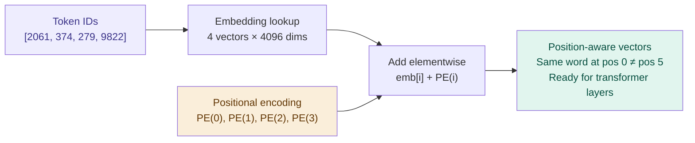

# Positional Encoding — Teaching the Model About Order

## Problem It Solves

Self-attention treats the input as a *set*, not a *sequence*. "France is beautiful" and "beautiful is France" would produce identical attention weights because the dot products are the same. We need to inject information about where each token sits in the sequence — without breaking the parallel computation that makes transformers fast.

## How It Works

### Original: Sinusoidal Encoding (Vaswani et al. 2017)

Add a fixed mathematical signal to each embedding before the first layer:

```
PE(pos, 2i)   = sin(pos / 10000^(2i/d_model))
PE(pos, 2i+1) = cos(pos / 10000^(2i/d_model))

Where:
  pos  = position in the sequence (0, 1, 2, ...)
  i    = dimension index
  d_model = embedding dimension
```

```
┌──────────────────────────────────────────────────────────┐
│  WHAT GETS ADDED TO EACH EMBEDDING                       │
├──────────────────────────────────────────────────────────┤
│  Token at position 0: embedding + PE(0) vector           │
│  Token at position 1: embedding + PE(1) vector           │
│  Token at position 2: embedding + PE(2) vector           │
│  ...                                                     │
│                                                          │
│  "France" at position 5 gets a different vector added    │
│  than "France" at position 1                            │
│  → Model can distinguish them!                          │
└──────────────────────────────────────────────────────────┘
```

### Modern: Rotary Position Embedding (RoPE) — LLaMA, Mistral

Instead of adding a vector, RoPE *rotates* the query and key vectors by an angle proportional to their position:

```
Q_rotated[pos] = Q[pos] × R(pos)  (rotation matrix)
K_rotated[pos] = K[pos] × R(pos)

Attention score = Q_rotated · K_rotated
               = Q · K × cos(pos_i - pos_j)

Key insight: the attention score depends on the RELATIVE
distance (pos_i - pos_j), not the absolute positions.
```

### Comparison

```
┌───────────────────┬───────────────────┬──────────────────┐
│  Method           │  Absolute/Relative│  Length limit     │
├───────────────────┼───────────────────┼──────────────────┤
│  Sinusoidal       │  Absolute         │  Fixed at train  │
│  (original paper) │                   │  (extrapolates   │
│                   │                   │  poorly)         │
├───────────────────┼───────────────────┼──────────────────┤
│  Learned absolute │  Absolute         │  Fixed vocab     │
│  (GPT-2 style)    │                   │  of positions    │
├───────────────────┼───────────────────┼──────────────────┤
│  RoPE             │  Relative         │  Better          │
│  (LLaMA, Mistral) │                   │  extrapolation   │
├───────────────────┼───────────────────┼──────────────────┤
│  ALiBi            │  Relative bias    │  Very good       │
│  (MPT, Bloom)     │                   │  extrapolation   │
└───────────────────┴───────────────────┴──────────────────┘
```

## When to Use This Understanding

- Explaining why LLMs have context limits (fixed position encoding = fixed max)
- Understanding why "needle in a haystack" performance degrades at long contexts
- Choosing model architectures for long-document tasks

## When Things Break

```
Position beyond training limit:
  If trained on 2K tokens, performance degrades past 2K
  (Some methods like RoPE extend better)
  
Identical tokens at different positions:
  "I love Paris. I want to visit Paris."
  Both "Paris" tokens get different position encodings
  → model knows they're different instances
```

## Trade-offs

| Absolute position encoding | Relative position encoding |
|---------------------------|---------------------------|
| Simple to implement | More complex |
| Fixed length ceiling | Better extrapolation |
| GPT-2 style | RoPE, ALiBi |
| Struggles > training length | Handles longer contexts |

## Real World Example

**GPT-2:** Learned position embeddings. Hard limit at 1024 tokens. Attempts to generate beyond this = garbage output.

**LLaMA-2:** RoPE with 4K context. Fine-tuned versions push to 100K+ via RoPE frequency scaling.

**Claude (Anthropic):** Supports up to 200K token contexts. Uses techniques to extend position encoding well beyond typical training lengths.

## Interview Soundbite

> "Self-attention is order-agnostic — the same tokens in different positions would produce identical outputs. Positional encoding fixes this by adding a position-specific signal to each embedding. Modern approaches like RoPE encode relative positions directly into the Q/K rotation, enabling better extrapolation to longer contexts than original sinusoidal encodings."

---

## Diagram


