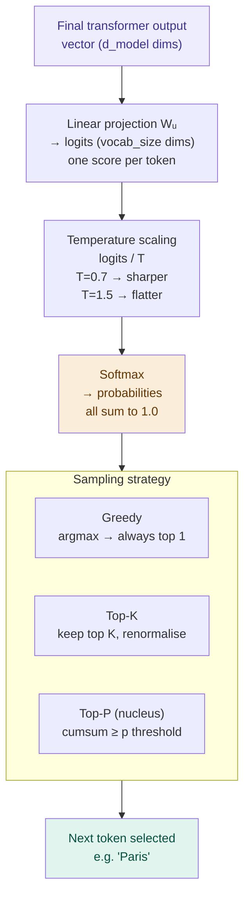

# Sampling — Picking the Next Token

## Problem It Solves

After the transformer computes a vector for "the most likely next token", we have raw scores (logits) for every possible vocabulary token. We need to convert these into an actual token choice. Pure greedy selection (always pick the highest) produces repetitive, boring text. Pure random selection produces gibberish. Sampling strategies tune the balance between quality and variety.

## How It Works

### Step 1: Output Head (Unembedding)

```
The last transformer layer produces a vector of shape (d_model,)
for the final token position.

A linear layer projects this to vocabulary size:
  logits = final_vector · W_unembed   shape: (vocab_size,)

One score per possible next token.
Raw scores (logits) can be any real number.
```

### Step 2: Temperature Scaling

```
Divide all logits by temperature T before softmax:

  scaled_logits = logits / T

T < 1.0  → sharper distribution  → more predictable
T = 1.0  → unchanged distribution → default
T > 1.0  → flatter distribution  → more random

softmax(logits / T) = probabilities
```

### Step 3: Softmax → Probabilities

```
p(token_i) = exp(logit_i / T) / Σ exp(logit_j / T)

All probabilities sum to 1.0
Higher logit = higher probability (but not exclusive)
```

### Step 4: Sampling Strategy

```
┌──────────────────────────────────────────────────────┐
│  GREEDY SAMPLING                                      │
│  Always pick argmax(probabilities)                   │
│  T effectively = 0                                   │
│  Use when: factual Q&A, code generation              │
│  Problem: repetitive, gets stuck in loops            │
├──────────────────────────────────────────────────────┤
│  TOP-K SAMPLING                                      │
│  Keep only top K tokens, renormalise, then sample   │
│  Typical K = 40-50                                  │
│  Cuts off the long tail of unlikely tokens          │
├──────────────────────────────────────────────────────┤
│  TOP-P (NUCLEUS) SAMPLING ← most common              │
│  Keep tokens whose cumulative prob ≥ p              │
│  Typical p = 0.9 or 0.95                            │
│  Dynamic: sometimes 2 tokens, sometimes 50          │
│  Adapts to the confidence of the distribution       │
├──────────────────────────────────────────────────────┤
│  BEAM SEARCH                                         │
│  Maintain B candidate sequences, expand each        │
│  Pick final sequence with highest joint probability  │
│  Use when: translation, summarisation, quality      │
│  Cost: B × slower than greedy                       │
└──────────────────────────────────────────────────────┘
```

## Temperature Effect on Example

```
Prompt: "What is the capital of France?"
After transformer layers → logits for next token:

  "Paris"    logit: 4.8
  "Paris,"   logit: 3.2
  "Lyon"     logit: 1.8
  "the"      logit: 0.9
  "a"        logit: 0.5

Temperature = 0.1 (low):        Temperature = 2.0 (high):
  Paris:   99.8%  ← dominant     Paris:    40%
  Paris,:   0.2%                  Paris,:   25%
  Lyon:     0.0%                  Lyon:     18%
  the:      0.0%                  the:      12%
  a:        0.0%                  a:         5%

→ Almost always picks Paris     → Often creative/wrong answers
→ Good for factual Q&A          → Good for brainstorming
```

## When to Use Which Setting

| Setting | Temperature | Top-p | Use case |
|---------|-------------|-------|----------|
| Factual | 0.0-0.3 | - | Code, maths, facts |
| Balanced | 0.7 | 0.9 | General chat (ChatGPT default) |
| Creative | 1.0-1.2 | 0.95 | Writing, brainstorming |
| Random | >1.5 | - | Rarely useful in practice |

## When NOT to Use High Temperature

- Code generation (syntax must be exact)
- Calculations (rounding to wrong answer)
- Factual questions (probability of hallucination rises)

## Trade-offs

| Low temperature | High temperature |
|-----------------|-----------------|
| Deterministic, reliable | Varied, creative |
| May be repetitive | May be incoherent |
| Factual accuracy better | More hallucination risk |
| Same input → same output | Same input → different each time |

## Real World Example

**ChatGPT API default:** `temperature=1.0`, `top_p=1.0`. Users commonly set `temperature=0` for code tasks.

**Claude:** Default temperature tuned per task type. Creative tasks get higher temperature than factual retrieval.

**GitHub Copilot:** Uses low temperature (~0.0-0.2) for code completion — you want the most likely correct completion, not a creative alternative.

## Interview Soundbite

> "The output head projects the final transformer vector to vocabulary-size logits. Temperature divides these logits before softmax — low T sharpens the distribution toward the most likely token, high T flattens it for variety. Top-p sampling then dynamically truncates to the smallest set of tokens whose cumulative probability exceeds a threshold, balancing quality and diversity."

---

## Diagram


