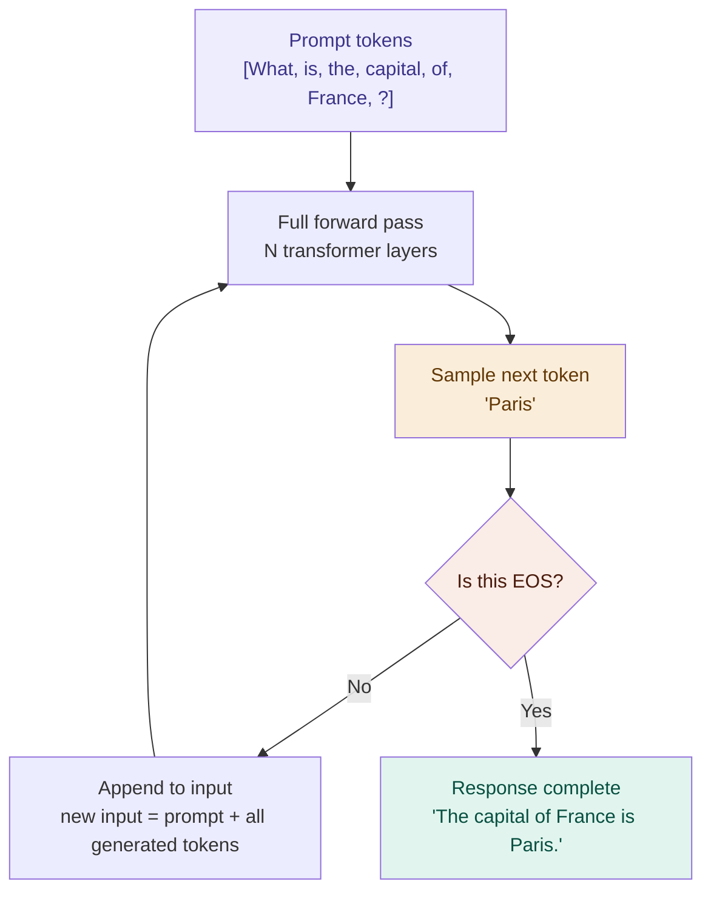
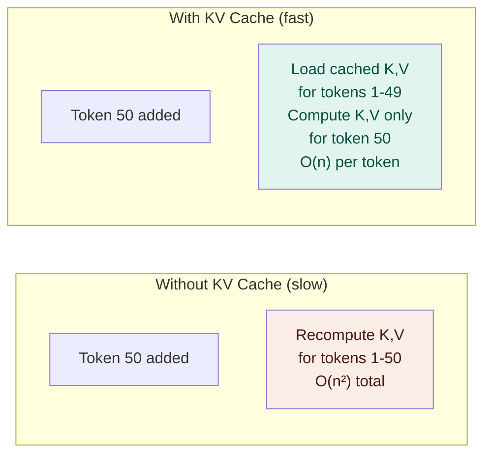

# The Generation Loop — Building a Response Token by Token

## Problem It Solves

We need to generate a full response — not just one token. The transformer only predicts one token at a time. The generation loop solves this by feeding each generated token back into the input and running again, building the response incrementally. This is called **autoregressive generation**.

## How It Works

```
┌──────────────────────────────────────────────────────────┐
│  AUTOREGRESSIVE GENERATION LOOP                          │
│                                                          │
│  Input: "What is the capital of France?"                 │
│                                                          │
│  Iteration 1:                                            │
│    Input tokens: [What, is, the, capital, of, France, ?] │
│    Forward pass → sample → "The"                        │
│    Append "The" to input                                 │
│                                                          │
│  Iteration 2:                                            │
│    Input tokens: [What, ..., ?, The]                     │
│    Forward pass → sample → " capital"                    │
│    Append " capital"                                     │
│                                                          │
│  Iteration 3:                                            │
│    Input tokens: [What, ..., The, capital]               │
│    Forward pass → sample → " of"                        │
│                                                          │
│  Iteration 4:                                            │
│    Input tokens: [..., The, capital, of]                 │
│    Forward pass → sample → " France"                    │
│                                                          │
│  Iteration 5:                                            │
│    Input tokens: [..., of, France]                       │
│    Forward pass → sample → " is"                        │
│                                                          │
│  Iteration 6:                                            │
│    Input tokens: [..., France, is]                       │
│    Forward pass → sample → " Paris"                     │
│                                                          │
│  Iteration 7:                                            │
│    Input tokens: [..., is, Paris]                        │
│    Forward pass → sample → "."                          │
│                                                          │
│  Iteration 8:                                            │
│    Forward pass → sample → <EOS> token                  │
│    END OF SEQUENCE token → stop!                        │
│                                                          │
│  Final response: "The capital of France is Paris."       │
└──────────────────────────────────────────────────────────┘
```

## Why This Is Expensive

```
Generating 100 tokens = 100 full forward passes

Each forward pass:
  - 96 transformer layers
  - Each layer: attention (O(n²)) + FFN
  - n grows with each new token

Token 1:   7 tokens in context   → fast
Token 50:  57 tokens in context  → slower
Token 100: 107 tokens in context → slower still

For GPT-4 class model:
  ~96 layers × 100 tokens × (attention + FFN compute)
  ≈ billions of floating-point operations per response
```

## The KV Cache — Making Repeat Passes Fast

```
PROBLEM:
  Each iteration re-computes K and V for ALL previous tokens
  Token 50 recomputes tokens 1-49 = wasted work!

SOLUTION: KV Cache
  Store K and V for each past token
  On each new iteration, only compute K, V for the NEW token
  Reuse cached K, V for all previous tokens

Speed gain:
  Without cache:  O(n²) per token, total O(n³)
  With KV cache:  O(n) per new token, total O(n²)

Memory cost:
  Must store K, V for all tokens in context
  GPT-3: 96 layers × 2 (K,V) × 12288 × n_tokens × 2 bytes
  At 4K context: ~9GB just for KV cache!
  At 100K context: ~225GB — why long contexts need big GPUs
```

## The EOS Token

```
Every model has a special End-Of-Sequence token (EOS):
  GPT models: token ID 50256 (<|endoftext|>)
  LLaMA: </s>

When the model generates EOS → stop the loop.

Without EOS: model would generate forever.
Trained to output EOS after completing a coherent response.

You can also set max_new_tokens to force-stop after N tokens.
```

## Generation Pseudocode

```python
def generate(prompt, max_tokens=200):
    tokens = tokenize(prompt)           # prompt → IDs
    
    for _ in range(max_tokens):
        # Full forward pass through all N layers
        logits = transformer_forward(tokens)
        
        # Only care about last token's prediction
        next_logits = logits[-1]        # shape: (vocab_size,)
        
        # Sample (temperature, top-p, etc.)
        next_token = sample(next_logits, T=0.7)
        
        # Stop if EOS
        if next_token == EOS_TOKEN:
            break
        
        # Append and continue
        tokens.append(next_token)
    
    return detokenize(tokens)           # IDs → text
```

## When to Use This Understanding

- Explaining why longer outputs cost more (linear in output length)
- Understanding latency vs throughput trade-offs in production
- Explaining why streaming (showing tokens as generated) is possible
- Understanding speculative decoding and other speed tricks

## When Things Go Wrong

| Problem | Cause | Fix |
|---------|-------|-----|
| Repetition loops | Model stuck in attractor state | Repetition penalty, higher temperature |
| Output cuts off | max_tokens reached | Increase max_tokens |
| Incoherent after ~1000 tokens | Attention degrades at long context | Use models with longer context windows |
| First token slow | Model loading / KV cache cold | Warm up the server |

## Trade-offs

| Autoregressive generation | Parallel generation (research) |
|--------------------------|-------------------------------|
| Simple, proven | Complex |
| Sequential — slow | Faster but needs multiple passes |
| Powers all current LLMs | Speculative decoding approximates this |
| Each token depends on all prior | Enables batching future tokens |

## Real World Example

**ChatGPT streaming:** The "typing" effect you see is just tokens arriving one by one from the generation loop. Each token is sent to your browser as soon as it is sampled.

**OpenAI API:** `max_tokens` parameter = max iterations of this loop. Billed per token = per loop iteration.

**Speculative decoding (Google, Apple M-series):** Small "draft" model generates K tokens speculatively in parallel; large "oracle" model verifies them all at once. If they match, all K tokens accepted in one pass — 2-5× speedup on hardware with spare capacity.

## Interview Soundbite

> "Generation is autoregressive: the model produces one token per forward pass, appends it to the input, then runs again. A KV cache avoids recomputing past tokens' keys and values, making each step O(n) instead of O(n²). The loop terminates when the EOS token is sampled or max_tokens is reached."

---

## Diagrams

### Generation loop



### KV Cache


